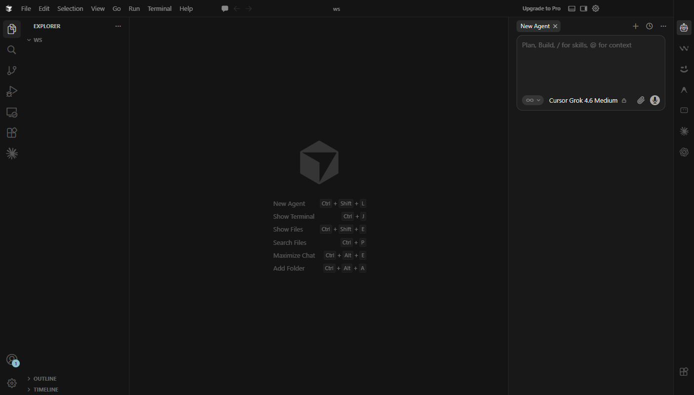

# cursor-custom

[English](README.md) | 日本語

**Cursor を「AI は右、ファイルは左」の画面にするツールです。**

Claude Code や Codex など、AI の拡張機能を Cursor の Agent と同じ右側にまとめます。画面の左端と右端に縦のアイコンバーを置き、左端でファイル一覧や検索、右端で AI を切り替えます（Google の Antigravity と同じような画面です）。



## できること

- **右端のアイコンで AI を切り替えられる**：Cursor Agent と、下の表の拡張機能を切り替えられます。右側のサイドバーを閉じてもアイコンは右端に残り、押すとその AI でサイドバーが開きます。
- **Agent のチャットは上部のタブで切り替えられる**：右側のサイドバーの上に、チャットがタブで並びます。右クリックで名前の変更や、チャットを閉じることもできます。右端の Agent のアイコンは 1 つだけで、押すと最後に使ったチャットが開きます（チャットが 1 つもなければ、新しく作ります）。
- **右端の一番下に「Customize」ボタン**：Cursor のルール・スキル・MCP などを設定する画面（Customize）を開きます。
- **右端の下部にアカウント**：Cursor にログインしていると、アカウントのアイコンを表示します。マウスを乗せると名前とプラン、押すと Cursor Settings を開きます。
- **Cursor の Agent レイアウトにも対応**：Agent レイアウトでは AI のサイドバーが左に来るので、縦バーも左端に移ります。Cursor を再起動しても、最後に使っていたレイアウト（Agent / Editor）のままです。
- **左端のアイコンも縦に並ぶ**：ファイル一覧・検索・Git などのアイコンを、サイドバーの上ではなく左端に縦に並べます。
- **左右それぞれ ON/OFF できる**：設定で、片側だけ元の見た目に戻せます（[切り替え方](#左右の縦バーを-onoff-したいとき)）。
- **アイコンの順番を変えられる**：ドラッグ＆ドロップで入れ替えられます。並べた順番は、Cursor を再起動しても残ります。
- **元に戻せる**：いつでも元の Cursor に戻せます。

右側にまとめられる拡張機能：

| 拡張機能 | 補足 |
| --- | --- |
| Claude Code | |
| Codex | |
| Antigravity | |
| Kimi Code | |
| Cody | |
| Windsurf | Cursor の拡張機能一覧にはありません。入れ方は[下](#windsurf-を使いたいとき)を見てください |

入れていない拡張機能は表示されないだけです。全部を入れる必要はありません。1 つも入れていなくても、右端には Cursor Agent のアイコンが表示されます。

## 必要なもの

- Windows（Mac・Linux には未対応です）
- Cursor（バージョン 3.24.12 で動作確認しています）

## 使い方

### 1. ダウンロードする

このページの緑色の **Code** ボタンから **Download ZIP** を選び、好きな場所に展開します。git を使える方は、次のコマンドで取得しても構いません。

```powershell
git clone https://github.com/takemikochan/cursor-custom.git
```

### 2. Cursor を閉じる

Cursor のウィンドウをすべて閉じてください。開いたままだと、インストールは中止されます。

### 3. インストールする

展開したフォルダにある **`install.cmd`** をダブルクリックします。黒い画面に `done.` と表示されたら完了です。何かキーを押して画面を閉じてください。

### 4. Cursor を起動する

右端に、縦に並んだアイコンが表示されます。

## 元に戻したいとき

Cursor を閉じてから、**`uninstall.cmd`** をダブルクリックします。

インストール前の状態に戻ります（Cursor の画面配置も元に戻ります）。

## こんなときは

### 左右の縦バーを ON/OFF したいとき

左右それぞれ、Cursor の設定で切り替えられます。OFF にすると、その側は Cursor 本来の表示に戻ります。

| 場所 | 設定名 | ON（縦バー） | OFF（Cursor 本来の表示） |
| --- | --- | --- | --- |
| 右端（AI） | `workbench.secondarySideBar.showLabels` | `false` | `true` |
| 左端（ファイル一覧など） | `workbench.activityBar.orientation` | `vertical` | `horizontal` |

手順：

1. 設定を変えます。`Ctrl+Shift+P` → `Preferences: Open Settings (UI)` で設定画面を開き、設定名で検索してください（`Ctrl+,` で開く Cursor 独自の設定画面には出てきません）。`settings.json` に直接書いても構いません。
2. Cursor を再起動します（ウィンドウをすべて閉じてから、もう一度起動）。左右とも、設定どおりに切り替わります。

右を変えた直後（再起動する前）は、表示が中途半端になります。OFF にした場合は、縦バーが消えて右側のサイドバーの上に文字のタブが並びます。再起動すると、設定どおりの表示になります。

`install.cmd` を最初に実行したときは、どちらも ON で設定します。すでに自分で設定している場合は、その値をそのまま使います。

### Cursor をアップデートしたら元に戻った

Cursor はアップデートのたびに本体のファイルを置き換えるため、見た目が元に戻ります。Cursor を閉じて、もう一度 `install.cmd` を実行してください。

### 拡張機能をあとから入れたら、アイコンが仮のものになっている

Cursor を閉じて、もう一度 `install.cmd` を実行してください。アイコンは、インストールのときに各拡張機能から読み込んでいるためです。

### 「Cursor が見つからない」と表示される

Cursor を標準以外の場所に入れていると、自動では見つけられません。PowerShell で、`Cursor.exe` のあるフォルダを指定して実行してください。

```powershell
powershell -ExecutionPolicy Bypass -File install.ps1 -CursorPath "D:\Program Files\cursor"
```

### 「Cursor is running」と表示される

Cursor がまだ開いています。Cursor のウィンドウをすべて閉じてから、もう一度実行してください。Cursor の中のターミナルから実行した場合も、このメッセージが出ます。

### Windsurf を使いたいとき

Windsurf は、Cursor の拡張機能一覧からは入れられません。次の手順で入れてください。

1. [Open VSX の Windsurf のページ](https://open-vsx.org/extension/Codeium/codeium)から、VSIX ファイルをダウンロードします。
2. Cursor で `Ctrl+Shift+P` を押し、`Extensions: Install from VSIX...` を選んで、ダウンロードしたファイルを指定します。
3. Cursor を閉じて、もう一度 `install.cmd` を実行します。

### GitHub Copilot は使えますか

使えません。Copilot Chat は VS Code に組み込まれたチャット画面の上で動きますが、Cursor にはその画面がないためです。

## 気をつけてほしいこと

- **起動直後に、右側のサイドバーが一瞬開いて閉じることがあります。** 右側のサイドバーを閉じたまま Cursor を起動したときに、右端のアイコンを作るために一度だけ開いています。
- **Cursor の画面配置が変わります。** 右の縦バーを ON にしたときに一度だけ、Cursor の「Editor」レイアウトに切り替えます（その後は、自分で Agent レイアウトに切り替えても構いません）。元のレイアウトは、右を OFF にするかアンインストールすると戻ります。
- **Cursor 本体のファイルを書き換えます。** Cursor の公式な機能ではありません。Cursor のバージョンによっては、表示が崩れることがあります。
- **Cursor の「インストールが壊れている」という警告は出ません。** 書き換えたファイルに合わせて、Cursor のチェック用の値も更新しているためです。

<details>
<summary>変更する内容の詳細</summary>

`uninstall.cmd` を実行すると、どれも元に戻ります。

| 場所 | 変更内容 |
| --- | --- |
| Cursor 本体の `workbench.html` | 見た目を変える CSS と、並べ替えを上下方向で効かせるスクリプトを読み込む行を 1 行追加します。2 つのファイル（`cursor-custom.css` / `cursor-custom.js`）は、同じフォルダに置きます |
| Cursor 本体の `package.json` | 起動時に右側の配置を設定どおりに整えるため、Cursor の起動ファイル（`"main"`）を、このツールの起動ファイル（`out/cursor-custom-main.js`）に差し替えます。このファイルは、配置を整えたあとに Cursor 本来の起動ファイルを読み込みます |
| Cursor 本体の `out` フォルダ | 起動時に、アカウントの表示名・アイコン画像の URL・プランだけを `cursor-custom-account.json` に書き出します（右端のアカウント表示用。メールアドレスやログイン情報は書き出しません） |
| Cursor 本体の `product.json` | 書き換えた `workbench.html` に合わせて、チェック用の値（チェックサム）を更新します |
| Cursor のキーボードショートカット（`keybindings.json`） | 「Customize」ボタンのために、`Ctrl+Shift+Alt+F12` に「Open Customize」を割り当てます。行末に `// cursor-custom` の印が付きます |
| Cursor の設定（`settings.json`） | `"workbench.secondarySideBar.showLabels": false` と `"workbench.activityBar.orientation": "vertical"` を追加します。行末に `// cursor-custom` の印が付きます。すでに設定済みの項目には触りません |
| Cursor の画面の状態（`state.vscdb`） | Cursor の起動時と `install.cmd` の実行時に、右の設定に合わせて書き換えます。右が ON のとき：レイアウトを Editor に切り替え、Cursor の「Open Chat as Editor Tabs」をオフにし、AI の拡張機能を右側のサイドバーに移します。右が OFF のとき：インストール前のレイアウトと配置に戻します |

</details>

## 開発者の方へ

- 見た目：[src/secondary-activitybar.css](src/secondary-activitybar.css)
- 動き（縦バーの配置・チャットのタブ・ボタン・ドラッグ＆ドロップ）：[src/secondary-activitybar.js](src/secondary-activitybar.js)
- インストール処理：[scripts/cursor-custom.js](scripts/cursor-custom.js)
- 右側の配置を整える処理（起動時にも動きます）：[scripts/state.cjs](scripts/state.cjs)。右側に移す拡張機能は、このファイルの `MOVED_VIEWS` に書いてあります。

## ライセンス

[MIT License](LICENSE)
